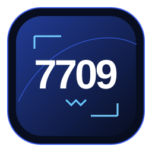
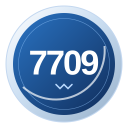

# WAGMIx 双语网页设计说明

客户从「產品」菜单认出底层资产 **7709.HK**，再用 **7709.W** 或 **SKHY2Lw** 选择产品。菜单、目录与详情页分别承担这三个层次的信息。下载仓库后，可直接打开[繁中入口](index.html)或[英文入口](WAGMIx_English_V18.html)查看完整交互。

|  |  |
|:---|:---|
| **7709.W** 采用深蓝方形。首页和列表中优先展示，详情页使用深色背景与白色字标与原色渐变 X。 | **SKHY2Lw** 采用银边蓝色圆形。浅色详情页使用标准 WAGMIx 字标，日期与 Solana 入口随本产品展示。 |

### 菜单与侧栏分别负责选页和定位章节

- 全站顶部保留「關於 WAGMIx」「產品」「生態」、语言切换及联系方式。「產品」下拉菜单先显示品类及两行底层资料，随后用独立产品条目显示 7709.W／SKHY2Lw 和网络，分别链接详情页。联系方式位于顶部右侧。
- 首页五项能力按平台、托管、流动性、架构、投研排序，采用最新截图的标题，仅显示标题和图形，不再设置能力导航。桌面五列，移动端 2＋2＋1。产品列表按产品代码、网络、状态排列，每行都可进入详情。
- 两款详情页均依序展示产品总览、底层行情、投资主题、核心卖点、产品资料与权利、产品文件。桌面侧栏显示产品代码和六个章节，窄屏目录可收起。切换语言时保留所在产品和章节。
- 生态页按产品与网络组合筛选。卡片默认只显示标志和名称，悬停、键盘聚焦或触屏点按后显示机构简介和来源。

### 版式用颜色和轮廓区分产品

基础正文色为 `#071E3B`，品牌蓝为 `#086BE8`，浅蓝底为 `#EEF6FF`。7709.W 详情使用 `#070C13` 深色底与高对比文字，页头和页脚的白色字标与原色渐变 X 直接贴背景。两枚产品图标均只刻「7709」，旁边的文本显示完整代码。图标单独使用时，以完整代码作为无障碍名称。

产品目录桌面主标题在 40–68 px 间缩放，菜单品类名为 23 px，底层资料为 16 px。字体为内嵌 Geist 与 Noto Sans TC，并保留系统字体回退。宽度 ≤900 px 时，顶部导航收起，产品表改为逐项标注的卡片。生态目录在 ≤780 px 时由三列改为两列。深色页的环形动效应响应系统的减少动态效果设置。

首页和页脚按语言展示品牌文案，来源为 `site-config.json` 的 `brand` 配置。英文标题为 **Define The Next Wave On‑Chain**，保留大小写及非断行连字符，不加句点；繁中标题为 **引領鏈上新浪潮**。英文宽屏两行、手机三行；繁中尽量完整呈现并以品牌蓝强调「新浪潮」。

英文简介：

> Powered by institutional liquidity, regulated custody, and 24/7 onchain infrastructure, WAGMIx brings curated Asian assets from leading asset managers to global markets.

繁中简介分成两句：

> 機構級流動性，合規託管，全天候鏈上連接。
> WAGMIx 聚焦亞洲精選資產，讓價值鏈接全球。

首页底部的地区标签、辅助标语和对应分隔线已移除；页面保留品牌背景图，按内容调整首屏高度。最终首页样式位于 `home-v18.css`。首页 X 在独立视觉区域按原图比例显示，避免导航栏及容器裁切。首页底部只保留一组品牌介绍与联系方式，其他页仅显示精简页脚。

两张首页产品横幅共用组件与尺寸规则，7709.W 深色在上，SKHY2Lw 浅色在下。桌面均为左侧文字、右侧图标，共用内边距、图标容器、文字层级及查看产品入口；手机采用相同的堆叠结构。外层网格使两张横幅保持等高，并允许内容随字号及视口增长。

### 生态简介使用官网口径，并区分品牌与法律主体

机构卡片的标志和简介采用下列官方来源。Finloop 的白色 SVG 使用 `#071a2e` 深色底板。Finloop 集团品牌与 Finloop Finance Limited 持牌子公司分别表述；复星证券简介说明其与复星财富控股的从属关系及所用集团标志。

| 条目 | 官方介绍 |
|---|---|
| CSOP | https://www.csopasset.com/en/about/overview |
| Fosun International Securities | https://www.fosunwealth.hk/us?index=1 |
| Finloop | https://finloop.global/en/about |
| Beosin | https://www.beosin.com/ |
| BNB Smart Chain | https://www.bnbchain.org/en/bnb-smart-chain |
| Solana | https://solana.com/ |

机构简介仅说明自身业务，具体合作关系、合约审计范围及产品部署以对应产品文件为依据。筛选中的产品与网络关系单独维护于 `v9EcoRelations`，不得由一般官网介绍推断。Finloop 标志来自 https://finloop.global/assets/finloop-logo.svg 。

### 网络、行情与权利采用各自的披露口径

7709.W 的网络标示为「BNB Smart Chain（擬部署）」。产品状态「即將上線」与网络部署状态分别呈现。SKHY2Lw 的 Solana 交易入口在有正式链接后才可启用。两款页面引用的历史行情均属 **7709.HK**，展示行情日期及币种。

发行架构名称仅出现于「產品資料與權利」和「產品文件」及其导读。两款产品的赎回资格、结算安排和文件应分别维护。SKHY2Lw 产品单页按当前语言下载，白皮书统一下载英文 PDF，中文译文仅供参考。

V16 按获批 Hum Revised 单页更新 SKHY2Lw 第 1–4 节及相关网页摘要。T0 说明适用于港股交易时段内外；无法可靠估值或交收时顺延。V18 首页能力仅展示标题，不展示 T0 条款；两款产品的安排仍按自身产品文件分别维护。投资主题以四卡呈现每日杠杆目标、月成交额、日均成交额与资产管理规模，数字及历史期间保持原口径。

单页下载采用 `WAGMIx_7709_產品單頁_繁體中文_Hum_Revised.pdf` 和 `WAGMIx_7709_Factsheet_EN_Hum_Revised.pdf`。两份单页使用获批交付原件；原始英文白皮书及逐条引文保持不变，导读标注其与新版单页的口径差异。完整差异记录见 [RELEASE_V16.md](RELEASE_V16.md)。

### 同一语义层级使用一致字号

最终 V18 样式依次为 `interface-v18.css`、`home-v18.css`、`ecosystem-v18.css`，加载在历史样式之后。正文桌面 18px、手机 17px；导航及表头 16–18px；卡片标题 22–28px；来源与注释 14–15px。字体以 400／500／600／700 四个字重内嵌在 HTML 中。中英文按相同语义层级排版，窄屏通过换行与减少列数处理。

首页五项能力标题来自获批截图：提供全天候鏈上資產、持牌券商提供託管、頂級做市流動性、機構級金融資產上鏈、深度投研鎖定風口。英文为对应译文。标题维护于 `content-map.json`；原有细项数据未重新展示。

生态页面采用深蓝视觉、现有产品与网络关系的 X 形示意，筛选只改变已记录关系的高亮及目录结果。官方机构介绍仍在悬停、聚焦或点按时显示。不要从装饰连线推导新的商业合作关系。

产品目录补充 SK 海力士股票 → 7709.HK → 7709.W／SKHY2Lw 的资产关系示意。两款产品有各自的资料及文件入口，不能将 SKHY2Lw 白皮书当作 7709.W 文件。

品牌资源从用户提供的 AI 文件导出为原生 SVG，字形路径与 X 的渐变保持来源；深色版本只把字标路径改为白色，未对整个图像使用反色滤镜。文件见 `assets/wagmix.svg` 和 `assets/wagmix-light.svg`。没有将原始 AI 编辑工程纳入公开仓库。

### 地区限制以美国为示例，演示与实际检测明确区分

默认离线演示不读取 IP，页面提供带演示标识的正常、美国受限及无法验证状态。限制弹窗采用 WAGMIx 深蓝及品牌蓝，英文和繁中均说明产品及服务不面向位于美国的人士，网站内容不应解读为对其招揽。当前国家仅为 `US`，不从 IP 推断国籍或居民身份。

限制状态锁定主体交互及滚动，焦点保留在可用控件内；不通过关闭按钮、背景或 Escape 放行。语言切换、重新检测及邮箱／X／Telegram 联系入口保持可用。演示状态切换仅用于此设计稿验收；生产模式必须忽略模拟参数。

正式接入的端点契约、服务端拦截及直接下载要求见 [GEO_ACCESS.md](GEO_ACCESS.md)。公开 GitHub 及离线 HTML 中的内容仍然公开，前端弹窗不构成实际访问限制。

页面和交互在 [src/scripts](src/scripts/)，样式在 [src/styles](src/styles/)，内容、数据和配置在 [src/data](src/data/)。更新图标时，同步核对[独立图标](assets/)与网页内嵌版本；更新网页后，用同一组产品与章节链接复核两个语言入口。
