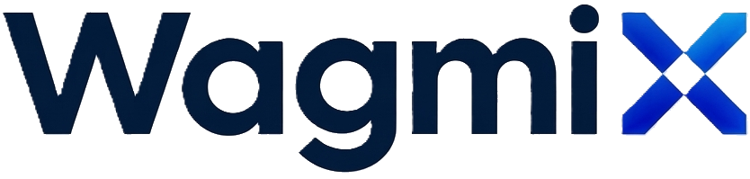

# WAGMIx 网站设计与双语网页 · V12



本项目是 WAGMIx 官网的本地 HTML 设计样稿，包含平台介绍、7709 产品目录、两款产品详情、产品文件阅读器及生态目录。**接手设计请先读 [DESIGN.md](DESIGN.md)**，其中有产品图例、导航层级、响应式规则和对应源码。

品牌口号统一为 **Define The Next Wave On‑Chain**。V12 按 R2 产品单页更新 SKHY2Lw 的营销内容及产品参数，并提供繁中、英文 R2 单页 PDF。英文白皮书继续作为完整产品条款的下载文件。

| 产品代码 | 底层资产 | 网络 | 页面识别 |
|---|---|---|---|
| **7709.W** | 港交所 7709.HK | BNB Smart Chain（拟部署） | 深色产品页、方形标识，目录首位 |
| **SKHY2Lw** | 港交所 7709.HK | Solana | 浅色产品页、圆形标识 |

### 在本地查看

下载并解压完整仓库，打开 `index.html` 进入繁中版，或打开 `WAGMIx_English_V12.html` 进入英文版。两页都能直接在本地浏览器运行。PDF 从旁边的 `downloads/` 目录读取。行情模块展示 7709.HK 的历史快照，数据截至 2026 年 10 月 28 日。

### 修改后重新生成网页

在仓库根目录执行以下命令。构建使用 Python 3 标准库，路由检查使用 Node.js 18 或更高版本。

```sh
python3 build.py
node tools/check.mjs
```

| 要修改的内容 | 源文件 |
|---|---|
| 双语顶部菜单、侧栏、语言切换和章节跳转 | [sidebar.js](src/scripts/sidebar.js) |
| 首页、产品目录、生态目录 | [main.js](src/scripts/main.js) · [catalog.js](src/scripts/catalog.js) · [ecosystem.js](src/scripts/ecosystem.js) |
| 7709.W 产品条款及深色详情页 | [adgm.js](src/scripts/adgm.js) · [adgm-v9.css](src/styles/adgm-v9.css) |
| SKHY2Lw 产品页及文件阅读器 | [product.js](src/scripts/product.js) · [docs.js](src/scripts/docs.js) · [白皮书节选](src/scripts/whitepaper-data.js) |
| 品牌色、字号、断点及产品标识 | [样式目录](src/styles) · [标识组件](src/scripts/product-marks.js) · [品牌资源](assets) |
| 展示日期、产品顺序及下载文件映射 | [site-config.json](src/data/site-config.json) |
| 可下载文件 | [英文白皮书及双语产品单页](downloads) |

编辑 `src/` 中的源文件后重新构建，两种语言的 HTML 会同步更新。查看产品条款时按产品代码分别进入对应文件。品牌标志、文件及行情数据保留各自来源和权利标识。
